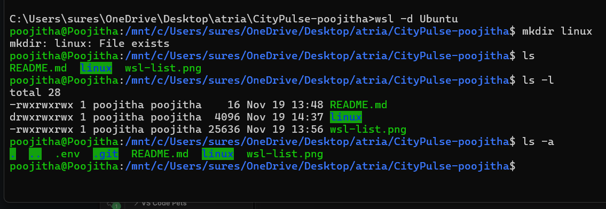

# CityPulse

This repository contains my practice of basic Linux command-line tasks, with screenshots of the commands I ran in the terminal.

## Task 1: Create and Remove Directories

`mkdir` creates a new directory and `rmdir` removes an empty directory.

```bash
mkdir temp-dir
rmdir temp-dir
```

`rmdir` works only when the directory is empty. To remove a directory that has files or subdirectories inside it, use `rm -r` or `rm -rf`.


## Task 2: Remove Files and Directories Recursively

`rm` removes a file. `rm -r` removes a directory along with everything inside it.

```bash
# Remove a single file
rm data4.txt

# Remove a directory and its contents
rm -r folder-name

# Remove a directory and its contents without asking for confirmation
rm -rf folder-name
```

> Warning: `rm -rf` deletes data permanently. Always check the path before running it.

## Task 3: Rename Files and Check Disk Usage

### Rename a File or Directory

`mv` is used to rename a file or directory:

```bash
mv data1.txt data5.txt
mv old-folder new-folder
```

`mv` can also move a file into another folder:

```bash
mv data3.txt data/data3.txt
```

### Check Disk Usage

`df -h` shows the free and used space on each mounted filesystem:

```bash
# it will show the size of files and the directories
df -h
```

```bash
# Size of every folder inside the current directory
du -h

# Total size of the current directory
du -sh

# Total size of a specific folder
du -sh linux
```



## Task 4: Linux Permissions

Every file and directory in Linux has three types of permission:

| Permission | Symbol | Meaning |
| --- | --- | --- |
| Read | `r` | Read a file or list the contents of a directory |
| Write | `w` | Change a file or add/delete files in a directory |
| Execute | `x` | Run a file as a program or open (`cd` into) a directory |

These permissions are set separately for:

- The owner (user)
- The group
- Others

View permissions with:

```bash
ls -l
```

Change permissions with `chmod`:

```bash
# Give the owner execute permission
chmod u+x script.sh

# Remove write permission from the group
chmod g-w data2.txt

# Owner can read/write, everyone else can only read
chmod 644 data2.txt

# Owner has full access, everyone else can read and execute
chmod 755 script.sh
```

Common permission numbers:

- `644`: owner can read and write; group and others can only read
- `755`: owner can read, write and execute; group and others can read and execute
- `777`: everyone can read, write and execute (not safe to use)

## Task 5: List Running Processes

`ps` shows the processes running in the current terminal:

```bash
ps
```

`ps aux` shows all processes running on the system:

```bash
ps aux
```

To find a particular process:

```bash
ps aux | grep bash
```

`top` shows a live view of running processes. Press `q` to exit.

```bash
top
```

## WSL and User Info

Checking that WSL is installed:

```bash
wsl --list --verbose
```


Checking the current user details:

```bash
whoami
id
hostname
```


## Screenshot Summary

| Screenshot | Description |
| --- | --- |
| `task1.png` | Creating and removing a directory |
| `linux-commands.png` | Linux file and directory commands |
| `wsl-list.png` | Checking that WSL is installed |
| `user-info-commands.png` | Commands showing the current user details |
