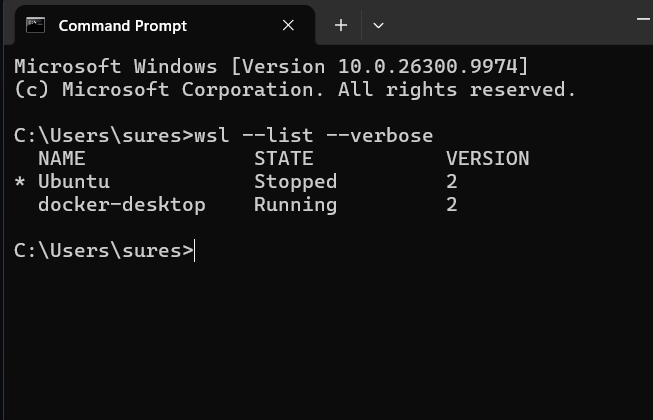
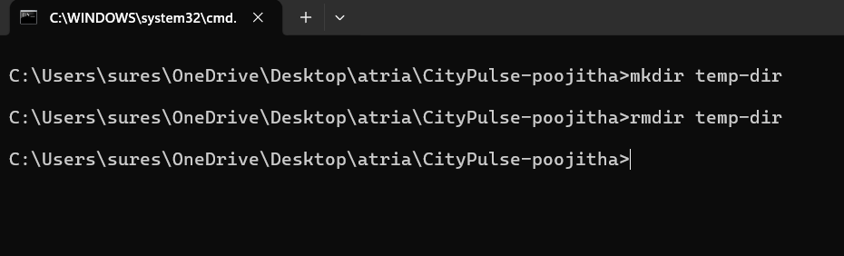
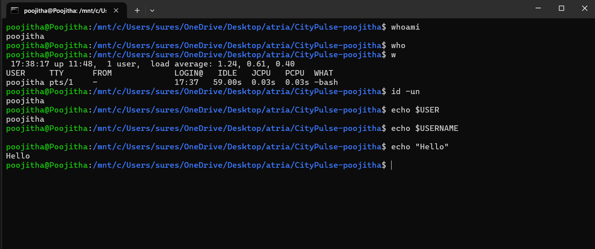

# CityPulse

This repo is my Linux command-line practice. I installed WSL and practised basic file, directory, permission and process commands. Screenshots of the commands are included.

## Setup: WSL

I checked that WSL is installed and listed my Linux distributions:

```bash
wsl --list --verbose
```



## Task 1: Create and Remove Directories

`mkdir` creates a directory and `rmdir` removes it. `rmdir` only works if the directory is empty.

```bash
mkdir temp-dir
ls
rmdir temp-dir
ls
```



## Task 2: Remove Files and Directories

`rm` deletes a file. To delete a directory that still has files in it, add `-r` (recursive).

```bash
rm data4.txt          # delete one file
rm -r old-folder      # delete a folder and everything inside it
rm -rf old-folder     # same, but never asks for confirmation
```

> Be careful with `rm -rf`. It deletes permanently and there is no recycle bin.

## Task 3: Rename Files and Check Disk Usage

### Rename / move with `mv`

```bash
mv data1.txt data5.txt        # rename a file
mv linux linux-practice       # rename a folder
mv data3.txt data/data3.txt   # move a file into a folder
```

### Disk usage

`df -h` shows free space on each mounted drive, and `du` shows how much space files and folders use. `-h` means "human readable" (K, M, G).

```bash
df -h          # space on all filesystems
du -h          # size of every folder under the current one
du -sh         # total size of the current folder
du -sh linux   # total size of the linux folder
```


## Task 4: File Permissions

Every file has three permissions:

| Permission | Letter | On a file | On a folder |
| --- | --- | --- | --- |
| Read | `r` (4) | read the contents | list the files |
| Write | `w` (2) | change the contents | add or delete files |
| Execute | `x` (1) | run it as a program | `cd` into it |

They are set separately for the **user** (owner), the **group** and **others**. `ls -l` shows them, e.g. `-rwxr-xr--`.

```bash
ls -l                    # view permissions
chmod u+x script.sh      # give the owner execute permission
chmod g-w data2.txt      # take write away from the group
chmod 644 data2.txt      # rw-r--r--
chmod 755 script.sh      # rwxr-xr-x
chmod 777 data6.txt      # rwxrwxrwx (everyone can do everything, avoid this)
```

## Task 5: Running Processes

```bash
ps                   # processes in this terminal
ps aux               # every process on the system
ps aux | grep bash   # find a specific process
top                  # live view, press q to quit
```

## User Info Commands

```bash
whoami     # current username
id         # user id and groups
hostname   # machine name
```



## Files in this Repo

| Path | What it is |
| --- | --- |
| `data/` | practice text files made with `touch`, `echo` and `cp` |
| `linux/` | practice text files used for the `mv`, `rm` and `chmod` tasks |
| `wsl-list.png` | WSL installed and listed |
| `task1.png` | `mkdir` and `rmdir` |
| `linux-commands.png` | file and directory commands |
| `user-info-commands.png` | user info commands |
